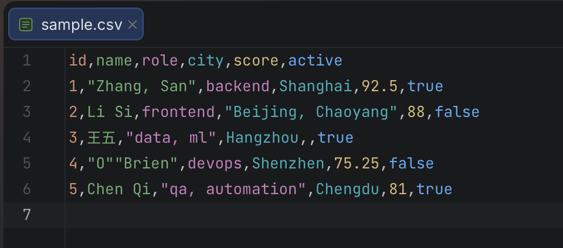

# Rainbow CSV for OpenIDEA

Plugin for highlighting CSV files in different colors.



## 功能

- **按列着色**：整列同一个颜色，相邻列不同，颜色按列循环。分隔符自动识别（`,` `;` `tab` `|`），引号内的分隔符不会误切。
- **光标列高亮**：光标停在某个字段里时，整列单元格被标记，其中光标所在行更醒目。
- **表头跟随列色**：首行的列名和它下面那一列同色，一列从表头到末行颜色不断开。
- **对齐 / 裁剪**：把列补齐成等宽（`Align Columns`），或去掉每个单元格首尾空白并保留引号（`Trim Cells`）。
- **字段间跳转**：`Next Field` / `Previous Field` 选中上一个/下一个字段，跨行连续移动。
- **分隔符自检**：`Show Delimiter and Columns` 报告检测到的分隔符、行数、列数。

## 设置

| 设置 | 默认 | 说明 |
| --- | --- | --- |
| `delimiter` | `auto` | `auto` 时按前 20 个非空行统计；也可固定为 `,` `;` `\|` `tab`。 |
| `colorCount` | `8` | 配色循环的列数，2–8。 |
| `highlightColumn` | `true` | 是否高亮光标所在列。 |
| `maxSizeKb` | `2048` | 超过这个大小的文件不着色，保证输入不卡。`0` 表示不限制。 |

## 一条硬限制：颜色不能自定义

OpenIDEA 的插件 API 不允许插件指定 hex 颜色。`syntax-provider` 只接受 24 种语义高亮类别
（`string`、`number`、`property`…），具体色值来自**当前配色方案**。所以这里的「彩虹」是
按列循环取一组「在 Darcula 主题下确实互不相同」的类别，而不是写死 RGB：

| 列 | 类别 | Darcula 色值 | 观感 |
| --- | --- | --- | --- |
| 0 | `keyword` | `#cf8e6d` | 橙 |
| 1 | `string` | `#6aab73` | 绿 |
| 2 | `property` | `#c77dbb` | 粉紫 |
| 3 | `number` | `#2aacb8` | 青 |
| 4 | `tag` | `#d5b778` | 金黄 |
| 5 | `function` | `#56a8f5` | 蓝 |
| 6 | `type` | `#bcbec4` | 灰白 |
| 7 | `builtin` | `#8888c6` | 灰蓝紫 |

顺序按**色相间隔最大化**排的：橙 23° → 绿 127° → 粉紫 313° → 青 186° → 金黄 43° → 蓝 208°，
相邻两列的间隔都在 90° 以上；超过 6 列时再补两个中性色（灰白、灰蓝紫），所以 8 列也各不相同。

换主题时具体色值会跟着变，但「相邻列不同色」这件事是稳定的。如果你的配色方案把其中几类
刷成同一个颜色，把 `colorCount` 调小（比如 4 或 6）反而更保险。

## 能力说明

插件申请两项能力：

- `editor.read`：读取当前聚焦编辑器的文本与选区，用于解析 CSV 和计算光标所在列。
- `editor.write`：仅用于 `Align Columns` / `Trim Cells` 两个命令改写文本（一次可撤销的整篇替换）。

不访问网络、不读其它文件、不启动进程。代码运行在 WebAssembly 沙箱中。

`cargo test` 里的 `mod audit` 用 `plugin.toml` 中**声明的确切能力集**跑真实命令与 provider
公开入口，并带一条反向对照：只给 `editor.read` 时，`Align Columns` 必须返回
`Denied("editor.write")` 且不改动文档。这样能力声明与实现一旦脱节，测试会直接失败。

## 构建与测试

需要 Rust（含 `wasm32-wasip2` target）与 `openidea-plugin` CLI：

```bash
cargo test                                          # 单元测试 + 能力审计，36 条
# RUSTFLAGS 把本机路径重映射掉，避免写进 wasm 的 panic 位置信息
PATH="$HOME/.cargo/bin:$PATH" \
  RUSTFLAGS="--remap-path-prefix=$HOME=/build" \
  openidea-plugin build                              # 编译 wasm 到 dist/plugin.wasm 并校验
```

SDK 依赖绑定 OpenIDEA v0.1.50 tag（插件 API 1.14）。

## 本地开发

```bash
openidea-plugin link            # 链接到本机 IDE，无需安装
# 在 设置 › 插件 中授权后打开任意 .csv；改代码后 build 再点「从磁盘重新加载」
```

## 许可证

MIT，见 [LICENSE](LICENSE)。
